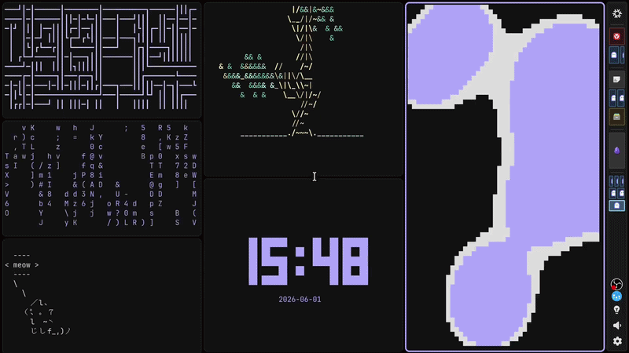

# Niri Minimap

A widget for your eww bar that displays an overview of your current windows and workspaces. I intend to extend this repo to include other widgets and eventually an entire shell.

## Demo



## Usage

1. Install the binary

Niri Minimap is only packaged for nix if you are on another distro, you will need to build from source. To install using nix add the flake in this repo to your system flake. Then install the package using home-manager.

```nix
inputs ={
  niri-minimap = {
    url = "github:Ori-Riaru/niri-minimap";
    inputs.nixpkgs.follows = "nixpkgs";
  };
}
```

```nix
home.packages = [inputs.niri-minimap.packages.<system>.default];
```

2. Copy or import the `yuck` markup into your existing setup. Replace the sections in `< >` with your config.

```lisp
(deflisten windows :initial ""
  "niri-minimap --output '<YOUR OUTPUT>' --height <DESIRED WINDOW HEIGHT>"
)

(defwidget minimap []
  (box :orientation "vertical"
      :class "minimap"
      :space-evenly false
      :width 1
    (literal :content windows)
  )
)
```

> [!Tip]
> Run the following to list available output names
>
> ```bash
> niri msg outputs
> ```

1. Add this css to your existing `scss` file, customizing it as you wish

```scss
* {
  min-width: 0;
  min-height: 0;
  margin: 0;
  padding: 0;
}

.minimap {
}

.window {
  border: 2px solid #3a3a3a;
  border-radius: 2px;
  background: #333;

  .focused {
    border: 2px solid #b0aafc;
    background: #46447f;
  }

  .urgent {
    border: 2px solid #e06b72;
    background: #2e1516;
  }
}

// Windows can be targeted using their a modified app id which allows for styling
// each application individually.
.window.vivaldi-stable {
  border: 2px solid #573033;
  background: #2e1516;

  .focused {
    border: 2px solid #e06b72;
    background: #331617;
  }
}

.window.com-mitchellh-ghostty {
  border: 2px solid #395674;
  background: #1a2b3d;

  .focused {
    border: 2px solid #88bddf;
    background: #395674;
  }
}

.window.org-gnome-Nautilus {
  border: 2px solid #564b28;
  background: #302712;

  .focused {
    border: 2px solid #f4da9d;
    background: #564b28;
  }
}

.divider {
  min-height: 2px;
  margin: 5px;
  border-radius: 3px;
  background: #333;
}
```

## Building from source

```bash
git clone https://github.com/Ori-Riaru/niri-minimap
cd niri-minimap
cargo build --release
```
